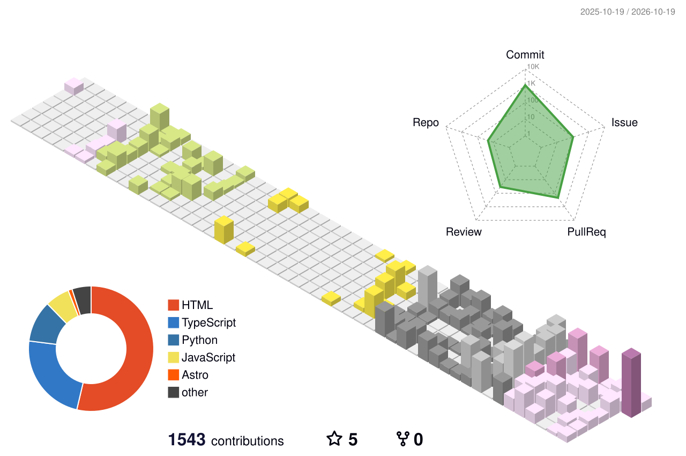

# Joshua Klyne Pudadera
### Full-Stack Developer · AI Automation Specialist

Computer Science Graduate (2025) · Backend AI Intern @ FlyRank AI · Published ML Researcher

Banga, South Cotabato, PH · Open to remote work

---

### About

- 🎓 BS Computer Science, Notre Dame of Marbel University (2021–2025)
- 🔭 Currently: Backend AI Intern @ FlyRank AI (Backend AI Engineering track) — FastAPI, Postgres, Docker, Supabase Auth
- 🧪 First-author published research on dengue forecasting with attention-based LSTM (IJLTEMAS, 2026 — see Featured Work)
- 📫 Open to: Junior Full-Stack, Backend, and AI Automation roles (remote)

---

### Tech Stack

**Core:**

**Also work with:**

---

### Featured Work

**[TVI-CAMS — Compliance & Batch Management System](https://github.com/shuakyle21/tesda-compliance-manager)** *(TypeScript · Next.js · Supabase · PostgreSQL)*
Internal system for tracking TESDA scholarship program batches (TWSP/CFSP) from onboarding through billing.
- Dependency-free TypeScript billing engine encoding government financial rules — cost tranching, subsidy calculations, audit-traceable outputs
- Batch lifecycle tracking with document compliance checks and role-based access

**[Nenita Farm Lechon Haus — Restaurant POS](https://github.com/shuakyle21/nenitafarm-lechonhaus)** *(React 19 · Supabase · TypeScript · Tailwind)*
Cloud-based restaurant management system owned end-to-end: order taking, staff rostering, catering bookings, financial reporting.
- Role-based access via Supabase RLS, real-time sales dashboard, automated PDF reporting
- Offline-first order sync for uninterrupted front-of-house operation

**[Improving Prediction of Dengue Outbreaks Using Attention-based LSTM Model with Honey Badger Optimization for Hyperparameter Tuning](https://dx.doi.org/10.51583/IJLTEMAS.2026.150600192)** *(Python · LSTM · Hyperparameter Optimization)*
Pudadera, Sombero, Dollaga, & Sueno (2026). *International Journal of Latest Technology in Engineering Management & Applied Science*, 15(6), 2621–2632. 
- Attention-based LSTM with Honey Badger Optimization for automated hyperparameter tuning, trained on 10 years (2015–2024) of epidemiological, climate, and geographic data for Koronadal City, South Cotabato
- Cut prediction error (MSE) by **43.7%** vs. a standard LSTM and **22.2%** vs. an attention-only LSTM

**[flyrank-backend-ai — Backend Internship Monorepo](https://github.com/shuakyle21/flyrank-backend-ai)** *(Python · FastAPI · PostgreSQL · Docker)*
Consolidated FlyRank AI Backend Engineering track: five self-contained projects, one per folder (BE-01 → BE-05).
- Progression from in-memory CRUD → SQLite persistence → Supabase JWT auth → containerized Postgres → polite scraping pipeline
- Docker Compose stack with healthchecks, named volumes, and gitignored `.env` setup; mocked pytest suite for the scraper

**AI Automation with n8n** *(n8n · Gemini · Google Workspace · Telegram)*
- [Telegram Receipt Processor](https://github.com/shuakyle21/telegram-receipt-photo-processing-automation) — receipt photos via Telegram, Gemini Vision extraction, date-based Drive archiving, Sheets logging with Drive links
- [Gmail Labels to Sheets & Drive](https://github.com/shuakyle21/-multi-label_gmail_to_google_sheets_-_drive_automation) — scheduled multi-label Gmail ingestion every 30 minutes, idempotent label/date/sender Drive hierarchy, per-email Sheets rows

More on the [portfolio](https://shua-kyle.me).

---

### 📊 GitHub & Activity Insights

